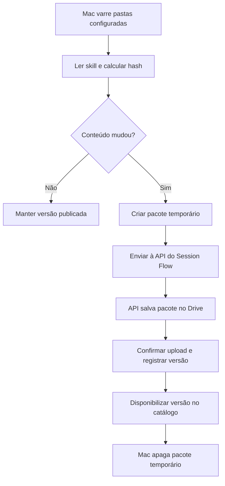
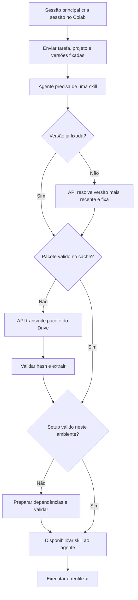

# Session Flow — distribuição de skills com Google Drive

Data: 23/10/2026  
Status: proposta de MVP para implementação no projeto existente.

## 1. Objetivo

Permitir que uma sessão aninhada, executada em um worker remoto como o Google Colab, descubra, obtenha e prepare as skills necessárias sob demanda. Reutilizar instalações válidas e reduzir o consumo de disco no Mac, no backend e no worker.

O Google Drive será o armazenamento central dos pacotes. O Session Flow manterá o catálogo e o controle das versões. O Mac será a origem inicial das skills, descobertas por varredura em pastas configuradas.

Este documento define o comportamento desejado. Nomes de endpoints, campos e componentes são propostas; adaptar à arquitetura real do repositório após inspecioná-lo.

## 2. Decisões do MVP

- Usar Google Drive como único provedor implementado inicialmente.
- Encapsular o storage em uma interface para permitir outro provedor no futuro, sem implementar MinIO neste MVP.
- Guardar pacotes imutáveis por versão; não sobrescrever pacotes já publicados.
- Manter catálogo, permissões e resolução de versões no backend do Session Flow.
- Centralizar autenticação Google no backend. Workers não recebem credenciais do Drive.
- Transmitir uploads e downloads em streaming, sem reter pacotes permanentemente no backend.
- Buscar a versão mais recente no primeiro uso da sessão, quando ainda não houver uma versão fixada.
- Fixar a versão durante a sessão. A sessão filha herda as versões já definidas pela sessão principal.
- Reutilizar pacote e setup quando ambos forem válidos no ambiente atual.
- Separar limite de cache de pacotes do controle de espaço ocupado por dependências instaladas.
- Não mover as pastas originais do Mac; a organização será feita pelo catálogo.

## 3. Responsabilidades

| Componente | Responsabilidade |
| --- | --- |
| Scanner no Mac | Descobrir SKILL.md, ler metadados, calcular hashes, detectar alterações e publicar pacotes. |
| API do Session Flow | Autorizar acesso, publicar, listar, resolver versões e transmitir pacotes. |
| Banco existente | Persistir catálogo, origem, escopo, versões, hashes e IDs dos arquivos no Drive. |
| Google Drive | Armazenar pacotes versionados e imutáveis. |
| Worker Mac/Colab | Resolver a skill, controlar cache, instalar, validar e disponibilizar ao agente. |
| Sessão | Manter as versões fixadas e referências às instalações em uso. |

O serviço de distribuição não deve depender da interface estar aberta. Depois da publicação, o Mac pode ficar desligado sem impedir downloads pelo Colab, desde que backend e Drive estejam acessíveis.

## 4. Fluxo de descoberta e publicação

### Varredura no Mac

- Configurar explicitamente as pastas globais e as raízes dos projetos.
- Executar varredura manual e na inicialização do componente responsável.
- Procurar SKILL.md e registrar origem, projeto/escopo, nome e descrição.
- Não fazer varredura indiscriminada de todo o disco.
- Definir identidade estável por escopo e origem; nome sozinho não identifica uma skill.
- Conteúdo idêntico pode ser deduplicado, preservando os registros de origem e as permissões.
- Mesmo nome com conteúdo distinto deve aparecer como conflito ou como skills diferentes, sem substituição silenciosa.
- Não apagar versões remotas automaticamente se uma pasta local desaparecer.

### Pacote e hashes

Incluir SKILL.md, manifesto, scripts, referências e recursos necessários. Excluir .git, .venv, node_modules, caches, modelos grandes e credenciais. Usar regras configuráveis de inclusão/exclusão; dependências necessárias devem constar no manifesto.

Calcular um hash de conteúdo canônico usando caminhos relativos e bytes dos arquivos incluídos, sem depender de timestamps. Calcular também o SHA-256 dos bytes finais do pacote para verificar o download. Não incluir o próprio hash do pacote dentro do conteúdo usado para calculá-lo.

Gerar o pacote em uma área temporária com limpeza em sucesso ou falha. A versão só se torna publicada após confirmação do upload. Se o upload terminar e o registro no banco falhar, permitir reconciliação do arquivo órfão por identificador de publicação.

## 5. Fluxo da sessão aninhada no Colab

### Descoberta e carregamento

A sessão recebe um catálogo leve com identificador, nome e descrição das skills autorizadas para o projeto, além da ferramenta ensure_skill. O conteúdo completo é carregado apenas quando necessário.

Integrar a disponibilização da skill ao mecanismo real do agente CLI: a instalação em disco, sozinha, não garante que uma sessão em execução consiga descobrir ou ler as instruções. A implementação deve comprovar o carregamento dinâmico ou usar o mecanismo de atualização suportado pelo runtime.

### Contrato proposto de ensure_skill

Entrada: skill_id e, opcionalmente, uma versão explícita. Projeto, sessão e permissões vêm do contexto autenticado.

Saída de sucesso: skill_id, version_id, content_hash, caminho local, setup_status e indicação de reutilização do cache. Saída de falha: código, etapa e motivo legível.

Ordem de resolução:

1. Se a sessão já fixou uma versão, reutilizá-la; rejeitar tentativa de trocar silenciosamente durante a execução.
2. Se houver versão herdada da sessão principal ou explicitamente definida na tarefa, fixá-la.
3. Caso contrário, consultar a API e fixar a versão publicada mais recente.
4. Verificar o pacote e o setup no ambiente atual.
5. Baixar e preparar apenas o necessário.

Fixar a versão de forma atômica para que chamadas concorrentes da mesma sessão não escolham versões diferentes. A versão mais recente significa a última publicação confirmada no catálogo, não o arquivo com data mais recente no Drive.

Uma versão incompatível com o worker deve gerar erro claro. O MVP não deve escolher silenciosamente uma versão antiga como alternativa.

## 6. Manifesto de instalação

Campos propostos:

| Campo | Finalidade |
| --- | --- |
| schema_version | Versão do formato do manifesto. |
| skill_id | Identidade estável no catálogo. |
| name / description | Descoberta pelo agente e identificação humana. |
| supported_platforms | Sistemas e arquiteturas suportados. |
| runtime_requirements | Python, Node ou outros runtimes necessários. |
| dependency_files | Arquivos de dependências e locks incluídos no pacote. |
| setup | Comando/script de preparação e timeout. |
| verify | Comando/script que confirma a instalação. |
| required_env | Nomes das variáveis exigidas, sem valores secretos. |

Não inferir comandos de instalação livremente a partir do texto da skill. Skills apenas documentais podem dispensar setup, mas devem passar pela validação básica. Skills existentes que precisem de dependências e não tenham manifesto devem aparecer como pendentes de configuração.

O setup deve ser idempotente e preferir ambientes isolados administrados pelo worker. Não remover dependências globais do host. Registrar READY somente após verificação bem-sucedida.

## 7. Cache e consumo de disco

### Mac

- Preservar as pastas originais.
- Criar pacote temporário apenas quando houver alteração.
- Apagar temporários após upload ou falha, com recuperação de resíduos após interrupções.
- Guardar localmente apenas metadados leves de sincronização, além das skills já existentes.

### Backend

- Persistir metadados no banco e pacotes no Drive.
- Fazer streaming com buffers limitados e controle de fluxo.
- Verificar que proxy, framework e servidor não estejam mantendo uploads/downloads inteiros em disco ou memória.
- Eventuais temporários inevitáveis devem ter limites e limpeza explícitos.

### Colab e outros workers

- Cache de pacotes por hash, com limite configurável. Valor inicial sugerido: 1 GiB, sujeito à configuração do usuário.
- Contabilizar arquivos compactados, conteúdo extraído e temporários na política de espaço local, evitando dupla cópia sem necessidade.
- Usar descarte por menor uso recente, preservando referências de sessões ativas e instalações em andamento.
- Antes de baixar/extrair, verificar espaço livre e limite de tamanho extraído.
- Se não houver espaço e todos os itens forem protegidos por uso, falhar com motivo claro; não remover arquivos ativos.
- Gerenciar dependências instaladas separadamente. O limite de pacotes não limita automaticamente .venv, pacotes Python, modelos ou outros recursos.
- Remover somente ambientes administrados pelo próprio módulo e sem referências ativas.
- Ao recriar o Colab, considerar perdido o estado de setup. Um pacote persistido não comprova que o novo runtime tem suas dependências instaladas.

Identificar o setup por versão da skill e identidade do ambiente, incluindo plataforma, arquitetura e runtime relevante. Usar lock por instalação para evitar download/setup duplicado em chamadas concorrentes.

## 8. Catálogo e API propostos

Reutilizar autenticação, banco e convenções já existentes no Session Flow.

| Operação | Endpoint ilustrativo | Resultado |
| --- | --- | --- |
| Listar catálogo | GET /projects/{projectId}/skills | Skills autorizadas, com metadados leves. |
| Resolver versão | POST /sessions/{sessionId}/skills/resolve | Versão fixa para aquela sessão. |
| Publicar | POST /projects/{projectId}/skills/{skillId}/versions | Upload e registro idempotente da publicação. |
| Baixar | GET /skills/{skillId}/versions/{versionId}/package | Streaming autenticado dos bytes. |
| Consultar instalação | Operação do worker integrada ao status da sessão | Estado, cache, erro e uso de espaço. |

O catálogo deve guardar skill_id, escopo/projeto, origem, descrição, version_id, content_hash, package_sha256, tamanho, drive_file_id, data de publicação e manifesto. A sessão guarda seu mapa de versões fixadas; o worker guarda o estado das instalações.

Estados mínimos de instalação: ABSENT, DOWNLOADING, INSTALLING, READY e FAILED. Pacote baixado e ambiente pronto devem ser registrados separadamente.

O backend guarda IDs reais de pasta/arquivo do Drive; nomes e caminhos visuais não são identificadores únicos. Usar autenticação Google adequada à conta escolhida, com renovação de tokens e credenciais protegidas no backend.

## 9. Falhas e integridade

- Autenticar scanner e workers e limitar acesso ao projeto/escopo autorizado.
- Validar SHA-256 antes da extração.
- Impedir caminhos absolutos, travessia de diretórios e links que escapem da pasta de destino na extração do tar.
- Aplicar limites de tamanho compactado/extraído e timeout de setup.
- Não publicar segredos junto dos pacotes nem registrar seus valores nos logs.
- Fazer instalação em diretório temporário e promover atomicamente após validação.
- Em falha, limpar estado parcial e permitir nova tentativa; nunca retornar READY por existir uma pasta.
- Com API/Drive indisponível, uma skill já fixada e pronta pode continuar sendo usada. Sem versão resolvida ou pacote disponível, informar indisponibilidade sem inventar uma versão.
- Tratar limites temporários da API do Drive com tentativas limitadas e espera progressiva, sem duplicar publicações.

## 10. Critérios de aceite e testes

| Cenário | Resultado esperado |
| --- | --- |
| Scan inicial com duas skills | Catálogo registra ambas com origem e escopo corretos. |
| Novo scan sem alterações | Nenhum novo pacote é publicado. |
| Alteração em script ou referência | Uma nova versão é publicada e o temporário é removido. |
| Duas skills com mesmo nome e conteúdos diferentes | Nenhuma sobrescreve a outra silenciosamente. |
| Upload falha | Nenhuma versão incompleta fica disponível no catálogo. |
| Primeiro uso no Colab | Resolve, baixa, valida, instala e disponibiliza a skill ao agente. |
| Segundo uso na mesma sessão | Não consulta novamente a versão nem repete download/setup válido. |
| Publicação durante sessão ativa | Sessão mantém versão fixada; nova sessão resolve a nova publicação. |
| Sessão filha com versão herdada | Usa exatamente a versão definida pela principal. |
| Duas chamadas concorrentes | Uma única instalação ocorre; ambas recebem a mesma versão pronta. |
| Pacote corrompido ou extração inválida | Instalação é interrompida antes da execução. |
| Dependência ausente ou setup falha | Retorna FAILED com motivo; nova tentativa pode recuperar. |
| Skill incompatível com Linux | Worker informa incompatibilidade sem executar setup indevido. |
| Cache cheio | Remove somente itens elegíveis ou informa falta de espaço. |
| Colab recriado | Não reutiliza um marcador antigo de setup como se fosse válido. |
| Mac desligado após publicação | Colab obtém pacote pelo backend e Drive. |
| Skill pronta e API temporariamente indisponível | Sessão continua usando sua instalação fixada. |
| Projeto não autorizado | API nega listagem/download/publicação daquele escopo. |

Fazer pelo menos um teste integrado real: publicar no Mac uma skill simples com script verificável, executá-la em sessão aninhada no Colab, repetir para comprovar cache e publicar uma alteração para comprovar o versionamento entre sessões. Documentar chamadas, hashes, estados e espaço consumido, sem expor credenciais.

## 11. Orientação ao agente implementador

1. Inspecionar o repositório atual: sessões aninhadas, workers, hooks, carregamento de skills, autenticação, persistência e integração com Colab.
2. Adaptar esta proposta às abstrações existentes, evitando criar uma segunda infraestrutura de sessões.
3. Implementar catálogo e storage Google Drive, scanner e publicação, resolução de versões e instalação no worker.
4. Integrar ensure_skill ao agente e demonstrar que ele consegue ler e usar a skill instalada durante a sessão.
5. Implementar limites de espaço, limpeza, locks, validação e tratamento de falhas.
6. Executar os testes pertinentes e registrar resultados reais, incluindo limitações do ambiente de teste.

Fora do MVP: MinIO, marketplace, sincronização bidirecional, atualização forçada de sessões ativas, instalação de todas as skills antecipadamente e remoção automática de versões remotas antigas.

## 12. Referências técnicas

- Google Drive — download de arquivos: https://developers.google.com/workspace/drive/api/guides/manage-downloads
- Google Drive — files.get: https://developers.google.com/workspace/drive/api/reference/rest/v3/files/get

As referências sustentam o uso do Drive para baixar pacotes binários. Os contratos e políticas deste documento são decisões propostas para o Session Flow, não funcionalidades prontas da API do Drive.
